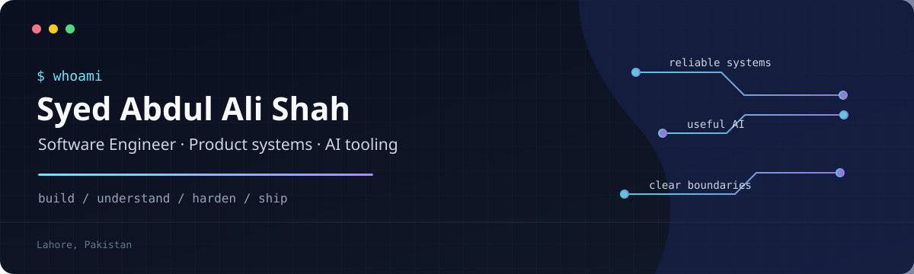

  

  <a href="https://syed-abdul-ali-shah.lovable.app">Portfolio</a>
  ·
  <a href="https://linkedin.com/in/syed-abdul-ali-shah">LinkedIn</a>
  ·
  <a href="mailto:syedabdulalishah.786@gmail.com">Email</a>

## Building software with a reason

I’m **Syed Abdul Ali Shah**, a Software Engineer working across product engineering, backend systems, and developer tooling. My current work spans **Laravel, Angular, Node.js, React, and Ionic/Capacitor**, with a focus on turning complex workflows into systems that are understandable, testable, and safe to operate.

At Ventech Studio, I work on international event-ticketing and fan-engagement products: Laravel APIs, Angular administration surfaces, cross-platform mobile applications, role-based access control, real-time voting, and content management. I also served as a Teaching Assistant for Data Structures and Algorithms at UET Lahore.

> **Engineering lens:** make the happy path useful, make the failure path explicit, and make the boundary between the two difficult to cross accidentally.

## Selected work

### [ShipCheck](https://github.com/shah541-g/ShipCheck) · AI website auditing

An end-to-end website auditor that explores public sites like a user and returns findings with evidence. I built the infrastructure and deployment path: provisioning a Vultr VM, configuring the firewall, deploying Docker services, wiring Object Storage and Serverless Inference, and running browser work in disposable **gVisor** sandboxes.

The interesting part is the containment model: strict URL policy, schema-validated browser actions, dangerous-click blocking, action limits, internal networking, secret isolation, and resource limits. The repository includes the [architecture](https://github.com/shah541-g/ShipCheck#architecture) and [containment proof](https://github.com/shah541-g/ShipCheck#containment-proof).

`Docker` `gVisor` `Playwright` `Vultr` `Serverless Inference` `Object Storage`

### [Regression Whisperer](https://github.com/shah541-g/regression-whisperer) · AI debugging knowledge base

A searchable knowledge base for turning recurring regressions into reusable debugging knowledge. The system combines a React interface with an Express/MongoDB API, JWT authentication, organization-aware data, analytics, voice input, CSV import, and Gemini-powered assistance.

The value is not just storing incidents; it is making the reasoning behind a fix discoverable for the next engineer.

`React` `Node.js` `Express` `MongoDB` `Google Gemini` `JWT`

### [Philbox / Ventech Project](https://github.com/shah541-g/Ventech-Project) · healthcare operations SaaS

A pharmacy and healthcare management platform with multiple role-specific workflows. As Project Manager and Backend Lead, I designed the three-layer backend architecture, four role-based modules, and more than 100 REST route groups, while implementing core administrative and customer-facing functionality.

The project is a practical study in authorization boundaries, inventory and branch state, appointment workflows, payments, notifications, and auditability.

`Node.js` `Express` `React` `MongoDB` `Socket.io` `Stripe` `JWT` `GitHub Actions`

### [PacMaze Adventures](https://github.com/shah541-g/PacMan-SpringBoot) · client-server desktop game

Pac-Man-inspired desktop software with a Java Swing client, Spring Boot REST API, MySQL persistence, MVC structure, Spring Security, and JPA/Hibernate. The repository documents both the implemented single-player path and the deliberately unfinished multiplayer boundary.

That explicit scope is part of the engineering story: a useful system is clearer when implemented behavior is separated from planned behavior.

`Java` `Spring Boot` `Java Swing` `MySQL` `Spring Security` `JPA/Hibernate`

### [SpecSim](https://github.com/shah541-g/SpecSim) · agentic requirements discovery

A two-agent simulator for practicing requirements discovery. One agent roleplays a stakeholder who reveals hidden facts only when asked relevant questions; an independent evaluator scores the resulting transcript against a deterministic requirement matrix.

The architecture makes the evaluation meaningful by separating conversation memory from judgment, validating structured model output, and keeping a deterministic fallback for model failure.

`Node.js` `Express` `LLM workflows` `Schema validation` `Experiment reporting`

## What I work on

| Area | Current focus |
| --- | --- |
| **Product engineering** | Laravel APIs, Angular dashboards, React applications, Ionic/Capacitor mobile apps |
| **Backend design** | Layered services, REST contracts, authorization, audit logs, workflow state |
| **AI systems** | Tool-constrained agents, retrieval-oriented knowledge bases, evaluation pipelines |
| **Infrastructure** | Docker deployments, Linux servers, firewalls, isolated browser execution, CI/CD |
| **Foundations** | Data structures, algorithms, OOP, databases, system design |

## Technical toolkit

  <code>JavaScript</code> <code>TypeScript</code> <code>Python</code> <code>Java</code> <code>PHP</code> <code>C++</code>
   
  <code>Node.js</code> <code>Express</code> <code>React</code> <code>Angular</code> <code>Laravel</code> <code>Spring Boot</code>
   
  <code>MongoDB</code> <code>MySQL</code> <code>PostgreSQL</code> <code>SQL Server</code>
   
  <code>Docker</code> <code>GitHub Actions</code> <code>AWS</code> <code>Vultr</code> <code>Git</code> <code>Postman</code>

## Beyond the headline projects

- **Roman Urdu → Urdu neural machine translation:** fine-tuned transformer models including ByT5 and NLLB-200, with an automated dataset-generation pipeline and experiments involving Mistral and Llama 3.1.
- **Systems practice:** a terminal code editor, client-server networking exercises, data-structure implementations, compression, and security-focused desktop applications.
- **Problem solving:** maintaining a [NeetCode 150 practice repository](https://github.com/shah541-g/Neetcode-150) and a [system design notebook](https://github.com/shah541-g/system-design).

## Connect

If you are working on a product where the workflow, architecture, or operational boundary matters as much as the interface, I’d be glad to talk.

**[Portfolio](https://syed-abdul-ali-shah.lovable.app)** · **[LinkedIn](https://linkedin.com/in/syed-abdul-ali-shah)** · **[GitHub](https://github.com/shah541-g)** · **[Email](mailto:syedabdulalishah.786@gmail.com)**
